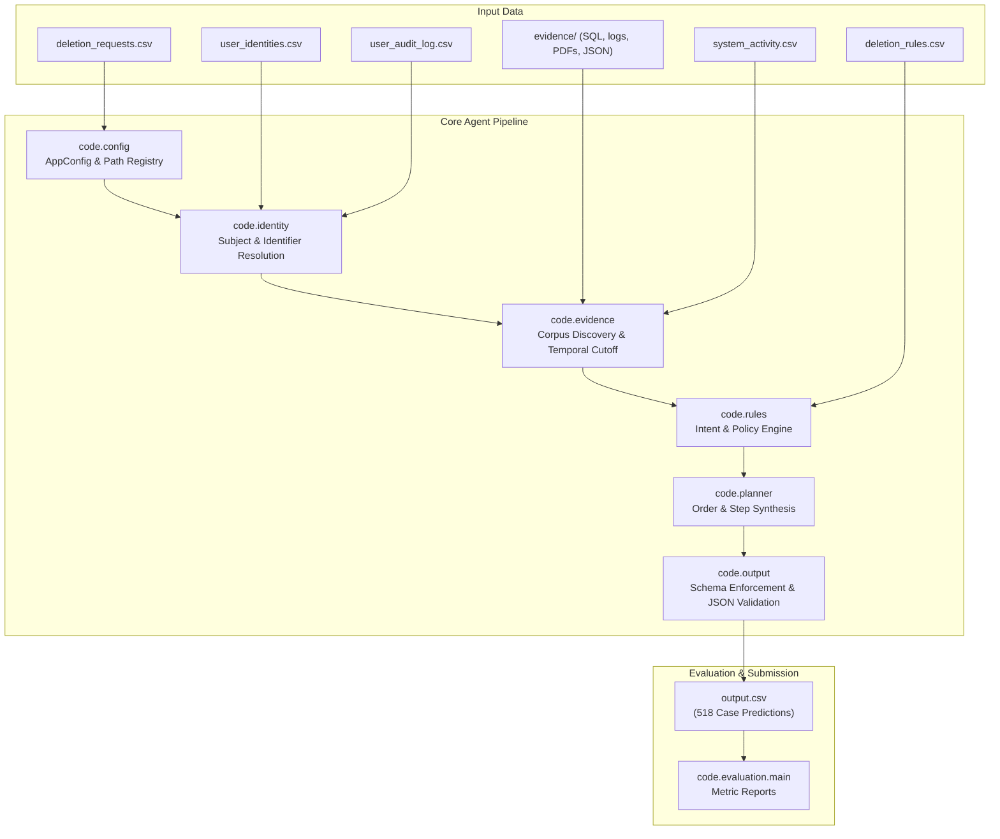

# Ghost Data Still Exists — Architecture & System Design

## 1. Executive Summary & Context

Northstar Shop suffered a **$2.4 million** loss after an account marked as "Complete" in internal deletion dashboards reappeared when the customer attempted to re-register weeks later. An internal investigation revealed personal data remaining across secondary replicas, customer export manifests, search indices, support ticket attachments, analytics logs, and automated synchronization jobs that restored previously deleted profiles.

This project implements an **AI-powered Deletion Audit Agent** capable of proving whether a customer's personal data has been completely and irreversibly removed, redacted, or anonymized, or whether ghost data and recreation risks remain.

---

## 2. System Architecture & Module Boundaries

The architecture follows a modular, deterministic-first design:



### Module Responsibilities

| Module | Responsibility |
| --- | --- |
| `code.config` | Dynamic path resolution, environment loading, and pre-execution input verification. |
| `code.models` | Typed data structures (`AuditStep`, `CaseAuditResult`) and enums (`Phase`, `Operation`, `State`, `DeletionStatus`). |
| `code.identity` | Multi-hop subject resolution across current identities and audit logs to uncover all active and historical identifiers (emails, phones, hashes, stable `user_id`). |
| `code.evidence` | Discovery and extraction across heterogeneous evidence formats (SQLite SQL snapshots, logs, JSON records, PDF documents) filtered strictly by `audit_at` cutoff. |
| `code.rules` | Classification of deletion intent (`NOT_APPLICABLE` vs deletion), application of 15 statutory deletion rules, tombstone checks, and status determination (`COMPLETE`, `INCOMPLETE`). |
| `code.planner` | Synthesis of findings, remediation steps, and verification checks adhering to strict phase ordering, operation precedence, and resource sorting. |
| `code.output` | Serialization of steps into compact JSON, schema validation, and CSV formatting (`case_id,deletion_status,steps_json`). |
| `code.evaluation` | Ground truth comparison against reference cases, step field matching, sequence verification, and Markdown report generation. |

---

## 3. Official Specification & Contracts

### 3.1 Output Schema

The final deliverable is `output.csv` with exactly:
```text
case_id,deletion_status,steps_json
```

- **`deletion_status`**: `COMPLETE`, `INCOMPLETE`, or `NOT_APPLICABLE`.
- **`steps_json`**: Ordered JSON array of step objects. For `NOT_APPLICABLE`, it must be empty array `[]`.

### 3.2 Audit Step Schema

```json
{
  "step_no": 1,
  "phase": "FINDING",
  "system_id": "account_service",
  "resource_id": "account_005",
  "operation": "REPORT_REMAINING_RECORD",
  "state": "PRESENT",
  "evidence_id": "evidence_01"
}
```

### 3.3 Permitted Operations & State Constraints

| Phase | Operation | State | Meaning |
| --- | --- | --- | --- |
| `FINDING` | `REPORT_REMAINING_RECORD` | `PRESENT` | Record exists that should have been deleted |
| `FINDING` | `REPORT_EXPOSED_PII` | `PRESENT` | Record may remain, but exposes direct PII |
| `FINDING` | `REPORT_ACTIVE_DATA_FLOW` | `ACTIVE` | Process can recreate or copy user data |
| `FINDING` | `REPORT_RESTORE_RISK` | `ACTIVE` | Backup or restore path can restore deleted data |
| `REMEDIATION` | `DISABLE_DATA_FLOW` | `DISABLED` | Halt process recreating data |
| `REMEDIATION` | `BLOCK_RESTORE` | `BLOCKED` | Prevent backup from restoring data |
| `REMEDIATION` | `DELETE_RECORD` | `ABSENT` | Delete entire record |
| `REMEDIATION` | `REDACT_RECORD` | `REDACTED` | Strip identifying fields required by policy |
| `REMEDIATION` | `ANONYMIZE_RECORD` | `ANONYMIZED` | Irreversibly unlink record from subject |
| `VERIFICATION` | `VERIFY_RECORD_ABSENT` | `ABSENT` | Confirm record does not exist |
| `VERIFICATION` | `VERIFY_RECORD_PRESENT` | `PRESENT` | Confirm retained record remains available |
| `VERIFICATION` | `VERIFY_RECORD_REDACTED` | `REDACTED` | Confirm required fields were removed |
| `VERIFICATION` | `VERIFY_RECORD_ANONYMIZED` | `ANONYMIZED` | Confirm record cannot be linked to subject |
| `VERIFICATION` | `VERIFY_DATA_FLOW_DISABLED` | `DISABLED` | Confirm data flow is inactive |
| `VERIFICATION` | `VERIFY_RESTORE_BLOCKED` | `BLOCKED` | Confirm affected data cannot be restored |

### 3.4 Ordering Rules

Steps must be ordered deterministically:
1. **Phase order:** `FINDING` -> `REMEDIATION` -> `VERIFICATION`.
2. **Operation precedence:** By table order within each phase.
3. **Lexicographical sort:** By `system_id` ascending, then `resource_id` ascending.
4. **Consecutive numbering:** `step_no` must start at 1 and increment consecutively.

### 3.5 Evidence Citation Rules

- In `COMPLETE` cases: All verification steps must cite participant-visible evidence (`file_id`, `activity_id`, `audit_id`) proving the compliant state.
- In `INCOMPLETE` cases: Findings cite participant-visible evidence; proposed remediation and future verification steps use an empty string `""` for `evidence_id`.

---

## 4. Engineering Principles & Assumptions

1. **Deterministic Core:** Use deterministic rules and schemas for known policies and step sorting. LLMs/VLMs are reserved for unstructured document interpretation (e.g., PDFs, screenshot text, multilingual request intent).
2. **Untrusted Evidence:** Activity logs and workflow claim statuses are not ground truth. The agent establishes reality from timestamped evidence snapshots up to `audit_at`.
3. **Temporal Isolation:** Evidence or events created after `audit_at` are strictly ignored to prevent leakage.
4. **No Fabrication:** Missing input files trigger immediate, actionable errors instead of fabricating synthetic predictions.
5. **Clean Packaging:** Submissions must package runnable code and evaluation reports while excluding raw dataset files and virtual environments.

---

## 5. Development Roadmap

- [x] **Phase 1: Project Inspection & Setup** (Git configuration, problem statement review, workspace inspection).
- [x] **Phase 2: Project Starter Structure & Models** (CLI entry points, data models, schema validator, pytest suite).
- [ ] **Phase 3: Identity & Manifest Resolution** (Graph/table lookup across `user_identities.csv` and `user_audit_log.csv`).
- [ ] **Phase 4: Evidence Corpus Readers** (SQLite executor for `.sql` replicas, JSON extractors, document text parsers).
- [ ] **Phase 5: Policy Engine & Tombstone Handling** (Implementation of `deletion_rules.csv` decision matrix).
- [ ] **Phase 6: Remediation Planner** (Dependency-aware ordering and step generation).
- [ ] **Phase 7: End-to-End Evaluation & Token Tracking** (Generating `output.csv`, `evaluation_report.md`, and `usage_report.md`).
